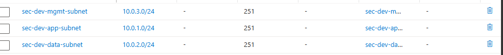
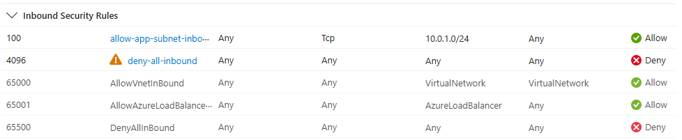
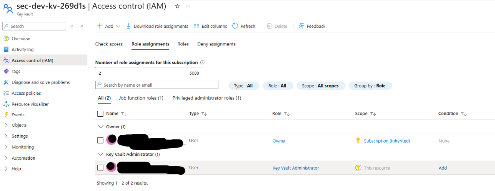
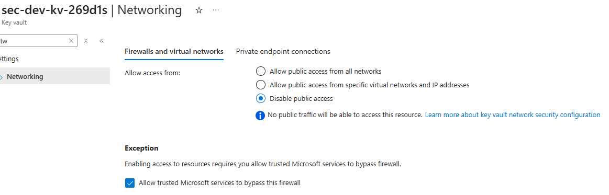

# Azure Secure Landing Zone (Terraform)

Secure Azure Landing Zone implemented with Terraform.

## Architecture

```
Azure Subscription
└── Resource Group (sec-dev-rg)
    ├── Virtual Network (10.0.0.0/16)
    │   ├── app-subnet    (10.0.1.0/24) ← NSG: HTTPS from internet only
    │   ├── data-subnet   (10.0.2.0/24) ← NSG: only from app-subnet
    │   └── mgmt-subnet   (10.0.3.0/24) ← NSG: VNet only, no internet
    ├── Key Vault (RBAC, soft-delete, public network access disabled)
    ├── Network Watcher
    ├── Defender for Cloud (Free tier, paid plans not enabled)
    └── Activity Log alert on Key Vault delete → email
```

## Security

| Principle | Implementation |
|---|---|
| Network segmentation | Every subnet has an NSG with deny-all inbound and explicit allows |
| Least privilege | Key Vault uses Azure RBAC: deployer gets Key Vault Administrator on the vault only |
| Secrets management | Key Vault with public network access disabled and network ACL deny-all |
| Monitoring | Activity Log alert + action group for Key Vault deletion |
| IaC security | tfsec + Checkov in CI, failing the build on findings |
| Tagging | All resources tagged: project, environment, owner, managed_by |

Defender for Cloud is set to the Free tier (foundational CSPM only) to keep the
lab at zero cost. In a real environment I would enable Defender for Servers,
Storage and Key Vault.

## Repository structure

```
.
├── main.tf              # Root module
├── variables.tf         # Input variables
├── outputs.tf           # Output values
├── locals.tf            # Local values (tags)
├── terraform.tfvars.example
├── .terraform.lock.hcl  # Pinned provider versions
├── .gitignore           # Excludes state and tfvars
├── .github/
│   └── workflows/
│       └── terraform-validate.yml   # CI: fmt, validate, tfsec, checkov
└── modules/
    ├── networking/      # VNet, subnets, NSGs
    ├── keyvault/        # Key Vault with RBAC
    └── security/        # Defender for Cloud, Monitor alerts
```

## Getting started

### Prerequisites
- [Terraform](https://developer.hashicorp.com/terraform/install) >= 1.5.0
- [Azure CLI](https://learn.microsoft.com/en-us/cli/azure/install-azure-cli)
- Azure free account

### Steps

```bash
# 1. Log in to Azure
az login

# 2. Get your Tenant ID
az account show --query tenantId -o tsv

# 3. Copy the example variables file
cp terraform.tfvars.example terraform.tfvars
# Edit terraform.tfvars: tenant ID, subscription ID, alert email

# 4. Initialize Terraform
terraform init

# 5. Check the plan
terraform plan

# 6. Deploy
terraform apply

# 7. Cleanup
terraform destroy
```

## Screenshots

Deployed to Sweden Central and checked in the portal before `terraform destroy`.

**Every subnet has an NSG**



**Data subnet NSG: only the app subnet is allowed in**



The portal flags `deny-all-inbound` with a warning because it also blocks the
default AllowVnetInBound and AllowAzureLoadBalancerInBound rules. That is
intended here, but a load balancer in front of this subnet would need an
explicit allow for its health probes.

**Key Vault uses Azure RBAC**



**Key Vault public network access is disabled**



## CI/CD Pipeline

GitHub Actions runs automatically on every push/PR:
- `terraform fmt`: format check
- `terraform validate`: syntax validation
- `tfsec`: IaC security scan
- `Checkov`: compliance scan

Both scanners fail the build on findings. Findings I accepted for this lab are
skipped inline with a reason (`#checkov:skip=...`):

| Check | Why it is skipped |
|---|---|
| Defender plans not on Standard (CKV_AZURE_19/55/84/87) | Paid plans, lab runs on Free tier |
| Key Vault purge protection (CKV_AZURE_110, CKV_AZURE_42) | Lab is destroyed every session, purge protection would block that |
| Key Vault private endpoint (CKV2_AZURE_32) | No private DNS in this lab, public network access is disabled instead |

## What I learned

- NSG rules are evaluated by priority, lowest number first. An explicit
  deny-all at 4096 overrides Azure's default AllowVnetInBound (65000).
- Key Vault RBAC puts vault access in the same IAM model as the rest of
  Azure, instead of a separate access policy list on the vault.
- Soft-deleted Key Vaults keep their name reserved, so the provider needs
  `purge_soft_delete_on_destroy` for a lab that is deployed and destroyed often.
- Running scanners with `soft_fail: true` hides findings, so the build
  should fail on them instead.

